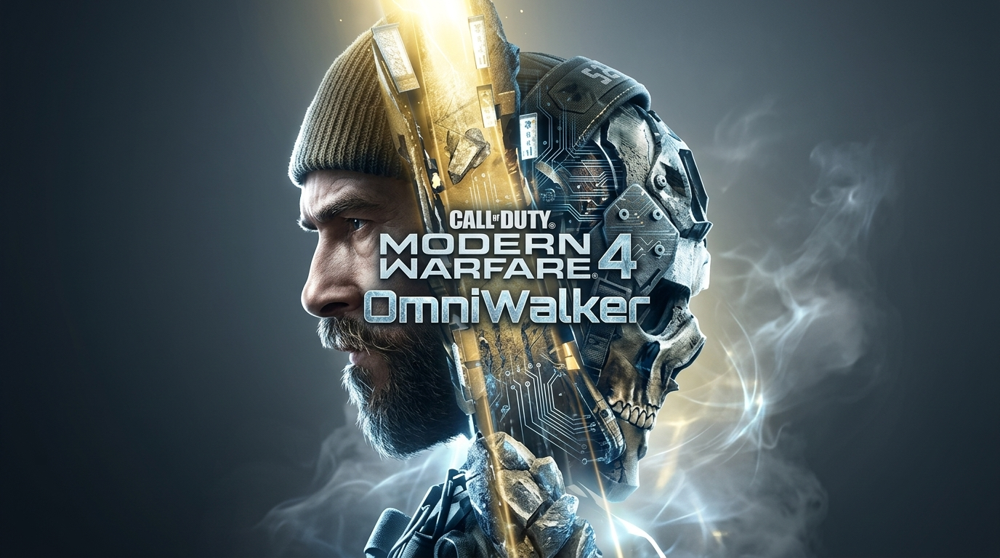

# 🎯 Call of Duty: Modern Warfare 4 - Ultimate QoL & Safe Client Mods

  

  

  
  
  
  

  <b>⬇ DOWNLOAD THE MOD PACK ⬇</b>

  

  
  

  

> 🎯 **Your complete toolkit for Call of Duty: Modern Warfare 4** — customize your HUD, improve visibility, and enhance your quality of life. Designed for **client-side only** use. 🛡️ **NO CHEATS** — this repository contains no aimbots, no ESP, and no memory injection. Only safe, client-side configuration tweaks for the PC version.

## 📖 About the Game

**Call of Duty: Modern Warfare 4** is the next mainline entry in the iconic FPS franchise, developed by **Infinity Ward** and **Beenox**, and published by **Activision**. The game launches on **October 23, 2026** for PC (Steam, Battle.net, Xbox on PC), PlayStation 5, Xbox Series X|S, and Nintendo Switch 2.

The campaign puts you in the boots of **Private Park**, a young South Korean soldier facing live combat for the first time during a North Korean invasion. Meanwhile, **Captain Price** operates as an outlaw outside the system he once served, waging a personal war from the shadows. Multiplayer features 12 all-new 6v6 maps at launch, while the **DMZ** extraction mode returns as a living combat sandbox.

**Key Game Features**:
- 🎯 **Ballistic Authority** — A new weapon-first tech stack unifying aiming, audio, and visibility for the most authentic gunplay yet
- 🗺️ **12 New 6v6 Maps** — Plus large-scale maps with vehicle and infantry combat
- 🪖 **DMZ Returns** — Loot, fight, negotiate, betray, and extract
- ⚙️ **RICOCHET Anti-Cheat** — Requires TPM 2.0 and Secure Boot on PC

## ⚠️ IMPORTANT WARNING — READ BEFORE USING

**Call of Duty: Modern Warfare 4 is an online multiplayer game protected by RICOCHET Anti-Cheat.**

| Enforcement Risk | Details |
|------------------|---------|
| **RICOCHET Anti-Cheat** | Kernel-level protection with TPM 2.0 and Secure Boot requirements |
| **Ban Risk** | **PERMANENT BAN** if detected using memory-editing tools |
| **This Repo** | Contains **NO CHEATS**. Only client-side config tweaks and HUD guides |

> 🚫 **DO NOT USE TRAINERS OR CHEATS.** RICOCHET actively monitors for memory tampering. Any injection will result in a permanent ban. This repository is strictly for **external configuration files and UI guides** that do not interact with game memory.

## 🔒 Safety & Security

| Safety Feature | Description |
|----------------|-------------|
| **No Memory Injection** | This repo contains no DLLs, no trainers, no memory readers |
| **External Config Only** | Guides and config file tweaks that modify settings before launch |
| **No Network Code** | No telemetry or online hooks |
| **Backup Recommended** | Always back up your config files |

## 🔥 Featured Content

### 🖥️ PC Performance & Visibility Guide

**Source:** Community | **Type:** Guide

A comprehensive text guide for optimizing your PC experience and improving visual clarity in Modern Warfare 4.

**What You'll Learn**:
- **Graphics Settings** — Which options to lower for maximum FPS without losing visibility
- **FOV Optimization** — Best field of view for different playstyles
- **Audio Tuning** — How to adjust audio propagation settings for better footstep detection
- **Driver Setup** — Recommended drivers for AMD, NVIDIA, and Intel Arc GPUs

### 🎮 HUD Customization (External)

**Source:** Community | **Type:** Config

Safe, external configuration tweaks for the HUD.

**What's Available**:
- **Crosshair Settings** — Community-recommended crosshair configs
- **Color Blind Modes** — Alternative HUD color schemes for better visibility
- **Minimap Tweaks** — Adjust minimap size and opacity via config files

> ⚠️ **Note**: These are **external configuration files only**. They do not inject code or read memory.

### 📊 Weapon Tuning Reference

**Source:** Community | **Type:** Spreadsheet

A reference sheet for weapon stats, attachment trade-offs, and meta builds based on community testing.

**Features**:
- **Damage Profiles** — Time-to-kill (TTK) for all weapons
- **Attachment Analysis** — Pros and cons of each attachment
- **Meta Loadouts** — Community-recommended builds for each playstyle

## 🚀 QUICK START

### Step 1 Verify Your PC Meets Requirements

1. **Enable** TPM 2.0 in your BIOS/UEFI
2. **Enable** Secure Boot in your BIOS/UEFI
3. **Download** the Call of Duty Secure Attestation Wizard from Activision to test your system
4. **Verify** your GPU meets the minimum specs (GTX 970 / RX 470 or better)

### Step 2 Pre-Load and Configure

1. **Pre-load** the game starting October 15, 2026
2. **Back up** your existing config files in `Documents\Call of Duty\`
3. **Apply** community-recommended graphics and HUD configs
4. **Launch** the game on October 23, 2026

### Step 3 Play Safe

1. **Never** use memory-editing tools in online matches
2. **Use** only external config tweaks and guides
3. **Report** any suspicious activity to Activision

## 📊 KEY FACTS

| Metric | Value |
|--------|-------|
| **Developer** | Infinity Ward, Beenox |
| **Publisher** | Activision |
| **Release Date** | October 23, 2026 |
| **Platforms** | PC, PS5, Xbox Series X|S, Switch 2 |
| **Anti-Cheat** | RICOCHET (TPM 2.0 + Secure Boot) |
| **Min RAM** | 8 GB |
| **Min GPU** | GTX 970 / RX 470 / Arc A580 |
| **Storage** | 115 GB (SSD required) |

## ❓ FAQ

### ❓ Is this a cheat or trainer?
**No.** This repository contains **NO CHEATS**. It is a collection of guides, external config files, and reference sheets. Modern Warfare 4 has kernel-level RICOCHET Anti-Cheat, and any memory injection will result in a permanent ban.

### ❓ Will I get banned for using these guides?
**No.** Reading guides and using external config files is completely safe. The game has no issue with players optimizing their settings outside the game.

### ❓ Why does Modern Warfare 4 require TPM 2.0 and Secure Boot?
These are hardware-based security features that allow RICOCHET to detect tampering at the system level. They are required to play **any online mode** in Modern Warfare 4 on PC. Without them, you will be restricted from online play.

### ❓ Does it work on Windows 11?
**Yes.** Fully compatible with Windows 10 and 11 (64-bit).

### ❓ Can I play on PS4 or Xbox One?
**No.** Modern Warfare 4 is a current-gen only title. There is no PS4 or Xbox One version.

### ❓ What are the system requirements?
Minimum: Intel Core i5-6600 / Ryzen 5 1400, 8 GB RAM, GTX 970 / RX 470, 115 GB SSD. Recommended (90 FPS High): Intel Core i7-8700K / Ryzen 5 3600, 16 GB RAM, RTX 3060 Ti / RX 6600 XT.

### ❓ Does it support crossplay?
**Yes.** The game supports crossplay across PC, PlayStation, and Xbox.

### ❓ What is DMZ?
**DMZ** is the extraction mode returning in Modern Warfare 4. You deploy solo or with a squad to loot, fight, negotiate, betray, and extract with whatever you can carry.

## 🛠️ System Requirements

Based on official Activision data:

| Component | Minimum | Recommended (90 FPS High) | Ray Tracing (4K Ultra) |
|-----------|---------|---------------------------|------------------------|
| **OS** | Windows 10 64-bit | Windows 11 64-bit | Windows 11 64-bit |
| **CPU (AMD)** | Ryzen 5 1400 | Ryzen 5 3600 | Ryzen 7 3700X |
| **CPU (Intel)** | Core i5-6600 | Core i7-8700K | Core i7-10700K |
| **RAM** | 8 GB | 16 GB | 32 GB |
| **GPU (AMD)** | RX 470 | RX 6600 XT | RX 9070 XT |
| **GPU (NVIDIA)** | GTX 970 / 1060 | RTX 3060 Ti | RTX 5070 Ti |
| **GPU (Intel)** | Arc A580 | Arc B580 | Not Supported |
| **VRAM** | 3 GB | 8 GB+ | 16 GB+ |
| **Storage** | 115 GB SSD | 115 GB SSD | 115 GB SSD |

## 📢 Disclaimer

> **Fan-made guide collection.** Not affiliated with Call of Duty: Modern Warfare 4 developers, Infinity Ward, Beenox, Activision, or any publisher.
>
> **Use at your own risk.** The author is not responsible for account bans, data loss, or damage.
>
> **NO CHEATS** — this repository does not contain any memory-editing tools. Modern Warfare 4 uses kernel-level RICOCHET Anti-Cheat.
>
> **Back up your config files before use!**

## 🌟 Support This Project

- ⭐ **Star** this repository
- 🔔 **Watch** for updates
- 🐞 **Report** issues
- 💬 **Share** with friends!

© 2026 • Call of Duty: Modern Warfare 4 • QoL & Safe Client Mods
